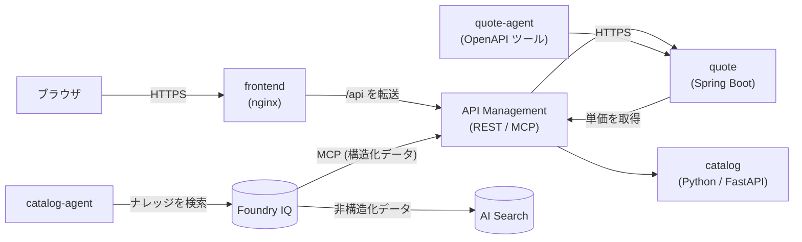
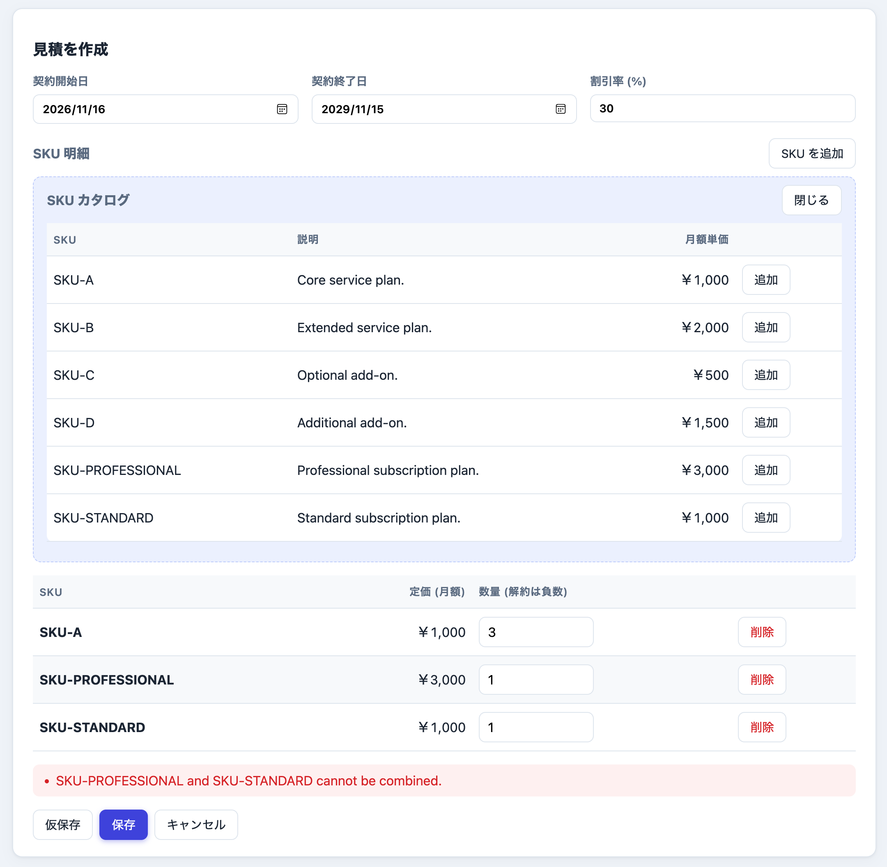
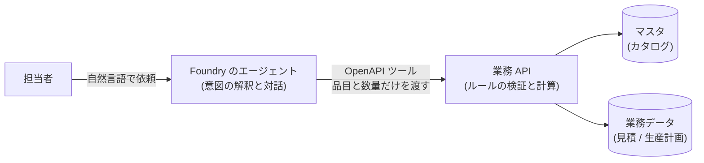

# 背景

## AI エージェントの定義

まず、AI エージェントの定義を確認しておく。どちらの定義も、エージェントが**ツールを使って行動する (アクションを実行する)** ことを含んでいる。

| 出典 | 定義 (原文) |
|---|---|
| Gartner | "autonomous or semiautonomous software entities that perceive, make decisions, take actions, and pursue goals" |
| Microsoft | "An AI agent is software that uses AI models and tools to pursue goals and complete tasks." ([Microsoft Cloud Adoption Framework](https://learn.microsoft.com/en-us/azure/cloud-adoption-framework/ai-agents/)) |

- 日本語の意味は、次のとおり。
  - Gartner: 知覚し、意思決定を行い、行動し、目標を追求する、自律的または半自律的なソフトウェアの実体。
  - Microsoft: AI モデルとツールを使って、目標を追求し、タスクを完了するソフトウェア。
- どちらも、**行動 (アクション)** が定義の中心にある。ナレッジやデータを読むだけでは、行動したことにならない。

## 読み取り専用のデータの限界

Foundry IQ や Fabric IQ で作ったナレッジやデータでは、アクションが可能なエージェントは作成できない。理由は、データが基本的に Read Only だから。

- Foundry IQ のナレッジや Fabric IQ のデータは、エージェントが**読む**ためのもの。
  - 検索して、回答の根拠にするところまではできるが、業務システムに**書き込む**ことはできない。
  - 検索するだけであれば、Web UI <--> AI Search で完結でき、LLM を挟むメリットが出しにくい。
- 見積の作成や保存のような、**状態を変える操作 (アクション)** には、書き込みができる API が別に必要になる。
- そこで、業務ルールを守ったまま、データを作成、更新、削除できる API を用意し、Foundry のエージェントが OpenAPI ツールとして呼び出す構成を作った。それがこのアプリケーションである。

| | 役割 | 読み取り | 書き込み | 業務知識 |
|---|---|---|---|---|
| Foundry IQ、Fabric IQ | 知識やデータを読んで、回答の根拠にする | できる | できない (Read Only) | ナレッジの文書に書く |
| このアプリケーションの API | 業務ルールを検証して、データを読み、作成、更新、削除する | できる (見積の取得と一覧、SKU の一覧) | できる (見積の作成、修正、保存、削除) | ドメインモデルに書く (金額の計算方法、契約種別の判定、見積の状態、SKU の組み合わせの制約、対象地域)。API の仕様 (OpenAPI) には、エージェントが読むための説明だけを載せる |

## Foundry IQ を使う場合

Foundry IQ は、**業務ルールがシステムとして存在しない場合**に実装する方がよい。

業務ルールがシステム (API) として存在する場合は、ルールの正は、そのシステムにある。そのルールを、ナレッジの文書として別に書くと、システムと文書の**二重管理**になり、システムを変更したときに、文書の直し忘れが起きる。

| 業務ルールの状態 | 実装する方がよいもの | 理由 |
|---|---|---|
| システムとして存在する (計算、検証、制約を、API が実行できる) | **API** を、OpenAPI ツールとして使う | ルールの正がシステムにあり、エージェントは、API を呼んで、結果を使う。ルールを文書に複製しない |
| システムとして存在しない (文書、手順書、担当者の知識にだけある) | **Foundry IQ** のナレッジ | 実行できるシステムがないので、文書を検索して、回答の根拠にする |

- Foundry IQ が向くのは、手順書、規程、製品資料、過去の事例、FAQ など、**システム化されていない知識**である。
- システム化されたルール (金額の計算、制約の検査など) は、Foundry IQ にも書かず、API に任せる。ルールの正はドメインモデルに書き、API の仕様 (OpenAPI) には、エージェントが読むための説明だけを載せる。
- 両方が必要な場合は、組み合わせる。たとえば、製品の使い分けの考え方 (システム化されていない知識) は、Foundry IQ から引き、見積の作成と金額の計算 (システム化されたルール) は、API に任せる。
- Foundry IQ のナレッジは、ルールを管理する担当と、**同じドメイン (同じチーム) が管理する**。別のドメインが管理すると、ルールの変更を知らず、直し忘れが起きやすい。

# quote

## 概要
見積を作成、保存、取得、削除する Web アプリケーションです。見積 API (quote)、SKU カタログ API (catalog)、画面 (frontend)、Azure のインフラ定義 (Bicep) で構成されます。



## Web UI の画面イメージ


## プロジェクト構成

| ディレクトリ | 概要 |
|---|---|
| [quote/](./quote) | 見積 API。Java 27 / Spring Boot 4。見積を提供し、単価は catalog から取得する |
| [catalog/](./catalog) | SKU カタログ API。Python / FastAPI。読み取り専用の SKU 一覧と単価を提供する |
| [frontend/](./frontend) | 見積管理画面。React / TypeScript / Vite |
| [infrastructure/](./infrastructure) | Azure リソースを作成する Bicep。Container Apps、ACR、Foundry |

### quote

- クリーンアーキテクチャーと DDD に沿って、`domain` / `application` / `adapter` / `configuration` へ分割している。契約種別の判定、金額計算、SKU の組み合わせ制約をドメインモデルが持つ。
- 見積の単価 (`listPrice`) は、作成と修正のたびに、見積が別サービスの catalog から取得する。リクエストでは SKU ID と数量だけを指定し、単価は指定できない。カタログに存在しない SKU は 400、catalog に接続できない場合は 503 になる。見積に保存される単価は、その時点のカタログの値である。
  - 見積のアプリケーション層のポート `SkuPriceProvider` を、`adapter/out/catalog` が実装し、catalog の `GET /api/skus/{sku}` を HTTP で呼ぶ。見積のモデルは、catalog のモデルを知らない。
  - catalog の URL は、`CATALOG_URL` (環境変数) で指定する。未指定の場合は `http://localhost:8000`。Azure 上では、API Management の `https://<ゲートウェイ>/catalog` を指定している。
- 金額は、解約明細を除いて集計し、全体の割引を適用して円単位に四捨五入する。
  - 明細の年額 (`annual`): `月額単価 x 12 x 数量`。割引前。解約明細は 0。
  - 年額合計 (`totalAnnual`): 各明細の `annual` の合計に割引を適用した、数量を含む1年分。
  - 合計金額 (`totalAmount`): 各明細の `月額単価 x 数量 x 契約月数` の合計。契約期間の総額。
  - 契約月数: 契約開始日から契約終了日までの暦の月数 (終了日を含む)。端数の日があれば1か月に切り上げ、同日契約は1か月。例: 2026-07-01 から 2029-06-30 は36か月。
- 見積はプロセス内メモリに保存する。再起動すると失われる。
- 見積の対象地域は日本のみで、地域を指定する項目はない。
- 認証は実装していない。
- 主な API は次のとおり。詳細は、実行中の quote が返す OpenAPI の仕様を参照する。SKU の一覧は、quote ではなく catalog が提供する。

| メソッドとパス | 内容 |
|---|---|
| `GET /api/quotes` | 見積の一覧 |
| `POST /api/quotes` | 見積を作成 (DRAFT) |
| `GET /api/quotes/{id}` | 見積を取得 |
| `PUT /api/quotes/{id}` | 見積を修正 (DRAFT に戻る) |
| `POST /api/quotes/{id}/save` | 見積を保存 (SAVED) |
| `DELETE /api/quotes/{id}` | 見積を削除 |

- 仕様は実行中の quote から取得できる: `/v3/api-docs` (JSON)、`/v3/api-docs.yaml` (YAML)。
- Swagger UI は `/swagger-ui` で開ける (例: http://localhost:8080/swagger-ui)。ブラウザから API を試せる。

### catalog

- Python (FastAPI) で実装した、読み取り専用の SKU カタログ。認証はない。サンプルの SKU はメモリに保持する。
- `domain` (SKU と ID の検証、取得元のポート)、`repository` (メモリの保存先とサンプルデータ)、`api` (HTTP の公開) に分けている。
- API は次のとおり。

| メソッドとパス | 内容 |
|---|---|
| `GET /api/skus` | SKU カタログの一覧 (SKU ID の昇順) |
| `GET /api/skus/{sku}` | SKU ID が完全に一致する SKU。大文字と小文字は区別する。存在しない場合は 404 |
| `GET /healthz` | 死活確認 (`ok`) |

- 仕様は実行中の catalog から取得できる: `/v3/api-docs` (JSON)。実装から生成するため、常に実装と一致する。
- Swagger UI は `/swagger-ui` で開ける (例: http://localhost:8000/swagger-ui)。画面の部品は CDN から読み込むため、インターネットへの接続が必要。
- ファイルとしての仕様は [catalog/openapi.json](./catalog/openapi.json) にある。`servers` はローカルの URL なので、Foundry へ登録するときは、デプロイ先の `/v3/api-docs` から取得した内容を使う。
  - API を変更したら、`cd catalog && .venv/bin/python -m app.export_openapi > openapi.json` で再生成する。実装と食い違うと、pytest が失敗する。

### frontend

- 見積の一覧、詳細、作成、編集、保存、削除ができる。
- SKU はカタログの一覧から選んで追加する。定価は表示だけで、入力も送信もしない (サーバーがカタログから決める)。
- API は `/api` の相対パスで呼び出す。開発時は Vite のプロキシ、Azure 上は nginx のプロキシが、`/api/skus` を API Management の `/catalog` へ、それ以外の `/api` を `/quote` へ転送する (環境変数 `CATALOG_URL`、`QUOTE_URL`)。ブラウザから見ると同一オリジンなので CORS は不要。

### infrastructure

[main.bicep](./infrastructure/main.bicep) が次のリソースを `swedencentral` に作成する。パラメーターは [main.bicepparam](./infrastructure/main.bicepparam) で指定する。

| リソース | 内容 |
|---|---|
| Azure Container Registry | コンテナーイメージの保存先。管理者ユーザーは無効 |
| Container Apps 環境 / Log Analytics | 実行基盤とログ |
| Container App `quote` | quote。外部公開、認証なし、レプリカは 1 固定 |
| Container App `catalog` | catalog。外部公開、認証なし (読み取り専用)。quote と frontend が呼び出す |
| Container App `frontend` | frontend。外部公開。Readiness probe (`/readyz`) は quote に届く間だけ OK (catalog は確認しない)。Liveness と Startup (`/healthz`) は nginx 自身だけを見る |
| ユーザー割り当てマネージド ID | ACR からイメージを取得する (AcrPull) |
| API Management | quote と catalog の REST API を取り込み、MCP サーバーとしても公開する。Basic SKU (MCP サーバーにできる SKU のうち、SLA のない Developer を除いて最安。作成に 30 分ほど)。認証なし |
| Azure AI Search | SKU の検索用。Basic SKU、API キー認証は無効 (Microsoft Entra ID のみ)。インデックス `sku-catalog` は `azd provision` の後に作成する |
| Foundry アカウントとプロジェクト | `AIServices`。埋め込みモデル `text-embedding-3-small` と、ナレッジベース用のチャットモデル `gpt-5.4-mini` (どちらも GlobalStandard、容量 50 = 50,000 トークン/分) をデプロイする。エージェント用のチャットモデルのデプロイは含まない |

quote はメモリに見積を保持するため、レプリカ数を 2 以上にすると、レプリカ間でデータが共有されない。

### API Management

- quote と catalog の仕様 ([quote/openapi.json](./quote/openapi.json)、[catalog/openapi.json](./catalog/openapi.json)) を取り込み、バックエンドは各 Container App にする。サブスクリプションキーは要求しない (認証なし)。
- 各 API は、REST と MCP の両方で公開する。MCP のツールは、各 API のすべての操作 (`operationId` の名前) である。

| API | REST | MCP (Streamable HTTP) |
|---|---|---|
| quote | `https://<ゲートウェイ>/quote/api/quotes` | `https://<ゲートウェイ>/quote-mcp/mcp` |
| catalog | `https://<ゲートウェイ>/catalog/api/skus` | `https://<ゲートウェイ>/catalog-mcp/mcp` |

- URL は `azd env get-values` の `apimGatewayUrl`、`quoteMcpUrl`、`catalogMcpUrl` で確認できる。
- 発行者のメールアドレスは、`azd env set APIM_PUBLISHER_EMAIL <メールアドレス>` で指定する。未指定の場合は、仮のアドレス (noreply@example.com) になる。
- API を変更したら、仕様ファイルを再生成する。quote は実行中のアプリの `/v3/api-docs` を、catalog は `python -m app.export_openapi` の出力を、`servers` 以外が同じになるように保存する (食い違うとテストが失敗する)。
- frontend から quote と catalog への呼び出しと、quote から catalog への単価の取得は、API Management を経由する。ゲートウェイの URL は、API Management が quote と catalog の URL を参照する循環を避けるため、名前から組み立てている (`https://<名前>.azure-api.net`。パブリッククラウドの形式)。
- 初回の `azd up` では、API Management の作成が終わるまで (30 分ほど)、frontend は転送先に届かず、quote は単価を取得できず 503 になる。frontend は、API の登録が終わってから起動する。
- quote と catalog は、外部公開のままなので、API Management を経由せずに直接も呼び出せる。経由を強制するには、VNet 統合などが別途必要である。

### AI Search のインデックス

- インデックス `sku-catalog` のフィールドは、次の 3 つ。定義は [sku-index.json](./infrastructure/search/sku-index.json)。

| フィールド | 型 | 内容 |
|---|---|---|
| `SKU_ID` | `Edm.String` | キー。全文検索、フィルター、並べ替えができる。セマンティック構成のタイトルになる。AI Search のフィールド名にはハイフンを使えないため、`SKU-ID` ではなく `SKU_ID` とする |
| `SUMMARY` | `Edm.String` | SKU の概要。全文検索の対象 |
| `SUMMARY_VECTOR` | `Collection(Edm.Single)` | `SUMMARY` の埋め込み。1536 次元、HNSW、コサイン類似度。取得はできない (`retrievable: false`) |

- Bicep ではインデックスもドキュメントも作成できないため、`azd provision` (`azd up`) の後に、[azure.yaml](./azure.yaml) の `postprovision` フック ([setup-search.sh](./infrastructure/hooks/setup-search.sh)) が REST API で、インデックスの作成と、ナレッジのドキュメントの登録を行う。何度実行しても同じ結果になる。
  - 実行する人には、Search Service Contributor と Search Index Data Contributor のロールが必要。Bicep が、デプロイの実行者に付与する。ロールの反映に数分かかるため、フックは失敗した呼び出しを再試行する (最大 5 分ほど)。`azd auth login` の認証で呼び出す。シェルと `curl` が使える環境 (macOS、Linux、WSL) を前提とする。
- API キーは使わず、次のロールを付与している。
  - Foundry のアカウントとプロジェクトのマネージド ID: Search Index Data Reader、Search Service Contributor
  - AI Search のマネージド ID (システム割り当て): Foundry のアカウントの Cognitive Services OpenAI User (vectorizer が埋め込みモデルを呼び出す) と Cognitive Services User (ナレッジベースがチャットモデルを呼び出す)
  - catalog (システム割り当てマネージド ID): Search Index Data Contributor
- catalog には、接続先を `AZURE_SEARCH_ENDPOINT` と `AZURE_SEARCH_INDEX_NAME` の環境変数で渡す (現時点では catalog は AI Search を使っていない)。
- `SUMMARY_VECTOR` の次元数 (1536) は、Foundry にデプロイした埋め込みモデル `text-embedding-3-small` に合わせている。別の埋め込みモデルに変える場合は、[main.bicepparam](./infrastructure/main.bicepparam) の `embeddingModelName` などと、sku-index.json の `dimensions` を、あわせて変更する。次元数は作成後に変更できないため、インデックスを削除して作り直す。
- [catalog/knowledge/](./catalog/knowledge) の Markdown (SKU ごとの概要) は、埋め込みにして、[sku-documents.json](./catalog/knowledge/sku-documents.json) に書き出してある。1 ファイルが 1 ドキュメントで、`SKU_ID` はファイル名、`SUMMARY` は Markdown の全文、`SUMMARY_VECTOR` は `SUMMARY` の埋め込みである。Markdown を変更したら、次のコマンドで再生成する (Foundry の埋め込みモデルを呼び出せるロールと、`az login` が必要)。

```bash
cd catalog
eval "$(azd env get-values | sed 's/^/export /')"
python3 scripts/build_knowledge_json.py
```

- インデックスには、次の設定がある。
  - **セマンティック構成** `sku-semantic-config` (既定): タイトルは `SKU_ID`、内容は `SUMMARY`。Foundry IQ のナレッジソース (検索インデックス) には、セマンティック構成が必要である。セマンティックランカーは無料枠 (月 1,000 リクエスト) にしている。超えると従量課金になるため、必要に応じて、`search.bicep` の `semanticSearch` を変更する。
  - **vectorizer** `summary-vectorizer`: Foundry の埋め込みモデルを、AI Search のマネージド ID で呼び出す。検索クエリのテキストを、サービス側でベクトルに変換できる (`vectorQueries` の `kind: "text"`)。
  - フィールドの属性は、既存のインデックスでは変更できないため、フックは、インデックスを削除してから作成し、ドキュメントを登録し直す。登録の間、インデックスは一時的に空になる。
- ナレッジソースとナレッジベースも、同じフックが作成する (定義は [infrastructure/search/knowledge/](./infrastructure/search/knowledge))。

| 名前 | 種類 | 内容 |
|---|---|---|
| `sku-index-ks` | 検索インデックス | インデックス `sku-catalog` (非構造化データ。SKU の概要) |
| `catalog-mcp-ks` | MCP サーバー (プレビュー) | API Management の `/catalog-mcp/mcp` (構造化データ。ツール `listSkus`、`getSku`) |
| `catalog-kb` | ナレッジベース | 上の 2 つを束ねる。LLM (`gpt-5.4-mini`) で、クエリの分解と回答の生成を行う。推論の強度は `low` (MCP のナレッジソースは `minimal` を使えない) |

  - 問い合わせは、`POST <検索のエンドポイント>/knowledgebases/catalog-kb/retrieve?api-version=2026-08-01-preview` で行う。MCP の呼び出しは遅くなることがあるため、`maxRuntimeInSeconds` を指定する。
  - 動作の例: 「ITSM Professional の特徴と月額単価」は、概要をインデックスから、単価を MCP から取得して答える。
  - MCP のナレッジソースは認証なしで APIM に接続する。APIM の MCP は、認証なしで外部公開している。
  - ナレッジソースとナレッジベースは、プレビューの API (`2026-08-01-preview`) で作成しているため、仕様が変わる可能性がある。
  - フックは、インデックスを削除する前に、これらを削除し、インデックスの作成後に作り直す。
- この JSON は、インデックスの `docs/index` API に、そのまま POST できる形式で、上記のフックが登録する。Markdown を変更したら、JSON を再生成してから、`azd provision` を実行する。JSON は、実行時には再生成しない (埋め込みの呼び出しに、追加のロールが必要になるため)。

## ローカルで動かす

必要なもの: JDK 27、Node.js 22 以上、Python 3.9 以上 (Azure 上では 3.13)。

```bash
# catalog (http://localhost:8000)
cd catalog
python3 -m venv .venv
.venv/bin/pip install -r requirements-dev.txt
.venv/bin/uvicorn app.main:app --port 8000

# quote (http://localhost:8080)。単価は catalog から取得するため、先に catalog を起動する
cd quote
./mvnw spring-boot:run -Dspring-boot.run.profiles=dev

# frontend (http://localhost:5173)
cd frontend
npm install
npm run dev
```

- ブラウザで http://localhost:5173 を開く。
- 別の場所の catalog を使う場合は、`CATALOG_URL` を指定する (例: `CATALOG_URL=http://localhost:9000 ./mvnw spring-boot:run`)。
- `dev` プロファイルは、`localhost:5173` からの CORS を許可する。Vite のプロキシ経由なら CORS は使われないが、直接 quote を呼ぶ場合に必要になる。プロファイルを指定しない場合は、CORS を許可しない。

## テスト

```bash
# quote: 単体テストと結合テスト (*IT)。結合テストでは catalog を固定の単価表に差し替えるため、catalog の起動は不要
cd quote
./mvnw verify

# catalog
cd catalog
.venv/bin/python -m pytest

# frontend: 静的解析とビルド
cd frontend
npm run lint
npm run build
```

## Azure へのデプロイ

[Azure Developer CLI (azd)](https://learn.microsoft.com/azure/developer/azure-developer-cli/) で、インフラの作成、イメージのビルド、アプリのデプロイを 1 コマンドで行う。構成は [azure.yaml](./azure.yaml) に定義している。

必要なもの: `azd` (1.37 以上で確認)、対象サブスクリプションでリソースを作成し、ロールを割り当てる権限。イメージのビルドは ACR Tasks で行うので、ローカルに Docker は不要。

### Windows で実行する場合の注意

`azd up` の後処理 (AI Search のインデックスの作成とナレッジの登録) は、シェルスクリプト ([setup-search.sh](./infrastructure/hooks/setup-search.sh)) で動く。Windows の PowerShell や、コマンドプロンプトから `azd.exe` を実行すると、このスクリプトは動かない。**Windows では、WSL (Ubuntu など) の中で実行する。** Windows 側の `azd.exe` は、WSL の `sh` を使わない。

- **ツールは WSL の中に入れる**: `azd`、`az` (Azure CLI)、`curl`、Python 3 を、WSL の Linux 側にインストールする。Windows 側のログイン状態は共有されないため、WSL の中で、`azd auth login` と `az login` をやり直す。ブラウザが開かない場合は、`--use-device-code` を付ける。
- **Windows 側のコマンドと混同しない**: WSL からは、Windows 側の `azd.exe` や `az.cmd` が見えることがある。`which azd` と `which az` が `/mnt/c/...` を指す場合は、Linux 版が入っていない。
- **リポジトリは WSL の中で `git clone` する**: 置き場所は `~/` の下にする。`/mnt/c/...` の下に置くと、遅くなる。また、Windows 側の Git で取得すると、`.sh` の改行が CRLF になり、`$'\r': command not found` のエラーで動かなくなる。
  - すでに CRLF で取得した場合は、`sed -i 's/\r$//' infrastructure/hooks/*.sh` で直せる。
  - このリポジトリには、`.sh` の改行を LF に固定する `.gitattributes` はない。
- **`curl` のバージョン**: スクリプトは、`--retry-all-errors` (7.71 以降) と `--fail-with-body` (7.76 以降) を使う。最近の Ubuntu は満たしている。
- **コマンドの書き方**: この README の、`eval "$(azd env get-values | sed ...)"` などは、bash の書き方である。PowerShell では動かないため、WSL で実行する。

### 初回

```bash
azd auth login
azd env new <環境名> --location swedencentral
azd env set AZURE_RESOURCE_GROUP <リソースグループ名>   # 事前に作成しておく
azd up
```

- リソースグループは `az group create -n <リソースグループ名> -l swedencentral` で作成しておく。[main.bicep](./infrastructure/main.bicep) はリソースグループ スコープのため、azd はグループを作成しない。
- すでに `az login` 済みなら、`azd config set auth.useAzCliAuth true` で azd がその認証を使える (この設定は azd 全体に影響する)。
- 完了すると、frontend、quote、catalog のエンドポイントが表示される。`azd env get-values` で `AZURE_CONTAINER_REGISTRY_ENDPOINT` などを確認できる。

`azd up` は次の順に実行する。

1. `azd provision`: [main.bicep](./infrastructure/main.bicep) でインフラを作成する。ACR が空の初回は、Container App に公開のプレースホルダーのイメージを指定する。
2. `azd deploy`: quote、catalog、frontend を ACR でビルドし、Container App のイメージを実際のものに差し替える。

### 更新

```bash
azd up            # インフラとアプリの両方
azd deploy        # アプリのみ
azd deploy quote
azd deploy catalog
```

- frontend、quote、catalog は API の契約でつながっているため、API を変更した場合は関係するサービスを同時に更新する (`azd up` または `azd deploy`)。
- `azd provision` を再実行しても、前回デプロイしたイメージが維持される (`azd` が環境に記録した `SERVICE_<サービス名>_IMAGE_NAME` を再利用するため)。
- サービス名の変更後、既存環境への初回更新は `azd up` を使い、サービスを識別するタグと frontend の接続設定も更新する。

### 動作を確認する

```bash
curl https://<frontend のホスト名>/healthz        # ok
curl https://<frontend のホスト名>/api/skus       # SKU 一覧 (nginx 経由)
curl https://<catalog のホスト名>/api/skus      # catalog を直接呼ぶ
curl https://<quote のホスト名>/api/quotes      # quote を直接呼ぶ
```

ブラウザで frontend のエンドポイントを開き、見積を作成できることを確認する。

### 削除

```bash
azd down --purge
```

`--purge` は、ソフト削除された Foundry アカウントを完全に削除する。付けない場合、同じ名前では再作成できないことがある。事前に作成したリソースグループは、`azd down` で中身ごと削除される。

### 注意

- 環境の作成 (Container Apps 環境) には、数分から十数分かかることがある。検証時は、初回の `azd up` が約 19 分かかり、その大半が Container Apps 環境の作成だった。
- ACR 名と Foundry 名には、リソースグループ ID から決まる接尾辞が付く。同じ名前で作り直すと、名前は同じになる。

## Foundry のエージェント

エージェントは、デプロイでは作成しない。Foundry のポータルで、手で作成する。デプロイは、エージェントが使う接続とナレッジベースまでを用意する。

| 用意されるもの | 内容 |
|---|---|
| 接続 `quote-openapi` | quote への、認証なし (匿名) の OpenAPI 接続。接続先は API Management の `/quote` (APIM 経由) ([foundry-connections.bicep](./infrastructure/modules/foundry-connections.bicep)) |
| 接続 `catalog-kb-mcp` | ナレッジベース `catalog-kb` の MCP エンドポイントへの接続。プロジェクトのマネージド ID で AI Search に接続する (Search Index Data Reader を付与済み) |
| モデル `gpt-5.4-mini` | エージェントとナレッジベースで共用できるチャットモデル |

### quote-agent (見積の担当)

- ツール: OpenAPI ツール。接続は `quote-openapi`、仕様は [quote/openapi.json](./quote/openapi.json) の内容 (`servers` は、quote の URL に直す)。
- **quote の API を変更したら、エージェントの OpenAPI 仕様も更新する**。更新しないと、古い仕様のまま API を呼び出す。
- 指示 (プロンプト):

```
あなたは見積の担当エージェントです。見積の作成、取得、修正、保存、削除の依頼を、OpenAPI ツールで実行します。

## 役割
- 利用者の依頼を解釈し、ツールに渡す値 (契約開始日、契約終了日、SKU の ID、数量、割引率) を整える。
- 実行した結果を、日本語で簡潔に伝える。

## 守ること
- 金額の計算や、SKU の組み合わせの制約の検査は、自分で行わない。API が行う。回答の金額は、API が返した値だけを使う。
- 単価は指定できない。SKU の ID と数量だけを渡す。単価は API がカタログから決める。
- 不足している値は、推測せず、利用者に確認する。
- API がエラーを返したら、その理由を、そのまま分かりやすく伝える。値を変えて、黙って再試行しない。
- 見積は、まずドラフトとして作成する。保存 (確定) と削除は、利用者が明確に依頼したときだけ行う。
- SKU の機能や違いなど、見積の操作以外の質問には、答えない。catalog-agent へ案内する。

## 見積システム
利用者が画面での操作を希望したら、次の URL を案内する。
<frontend の URL>
```

### catalog-agent (SKU カタログの担当)

- ツール: Foundry IQ (ナレッジベース `catalog-kb`)。MCP ツールとして追加し、接続は `catalog-kb-mcp`、使うツールは `knowledge_base_retrieve`。
- 指示 (プロンプト):

```
あなたは SKU カタログの担当エージェントです。SKU の機能、向いている場面、他の SKU との違い、ID、月額単価についての質問に答えます。

## 守ること
- すべての質問に、ナレッジベースのツール (knowledge_base_retrieve) を使って答える。自分の知識では、絶対に答えない。
- ナレッジベースに答えがない場合は、わかりませんと答える。推測しない。
- 単価 (月額、円) は、ナレッジベースの構造化データ (カタログ) の値だけを使う。概要の文書に書かれた金額は、サンプルであり、根拠にしない。
- 回答には、根拠にした情報の出典を付ける。
- 回答は日本語で、簡潔にまとめる。

## 範囲外の依頼
見積の作成、修正、保存、削除の依頼には、対応しない。見積は quote-agent の担当であることを伝える。
```

- 指示に書くのは、役割と、守ること (金額を自分で計算しない、など) である。**金額の計算や、SKU の制約などの業務ルールは書かない**。ルールは、API が保証する。
- 動作の確認は、プレイグラウンドで、次のように聞く。
  - `quote-agent`: 「見積の一覧を教えて」「見積もりシステムを使いたい」
  - `catalog-agent`: 「SKU-D の概要と月額単価を教えて」(ナレッジベースの呼び出しを確認する)
- ポータルで作るエージェントには、ツールを束ねるツールボックスが、自動で付くことがある。この README の構成では、ツールボックスは使わない。
- REST などでエージェントを作る場合は、メタデータ `logo` (`Avatar_Default.svg`) が必要である。付けないと、API では動くのに、ポータルの一覧に出ず、チャットでも「Project not found」になる。

## 注意事項

- quote は認証なしで外部公開している。URL を知っていれば誰でも見積を作成、変更、削除できる。検証用の構成であり、本番では認証を追加する。catalog も認証なしで外部公開しているが、読み取り専用である。
- `quote-agent` の OpenAPI ツールは、匿名で quote を呼び出す。ナレッジベースは、匿名で APIM の MCP を呼び出す。

## 応用シナリオ: 製造業の生産計画

このデモの題材は見積ですが、構成は、生産管理システムなどへの生産計画の登録にそのまま応用できます。製造業のお客様に説明するときは、見積を生産計画に読み替えてください。

### このデモが示していること

自然言語の依頼を、業務ルールを守った形で、業務システムに登録する構成です。



- **エージェントは、依頼の解釈と対話だけを担当**します。金額の計算、制約の検査、マスタの参照は、エージェントにさせません。
- **業務ルールは、業務 API (ドメイン) が保証**します。エージェントが誤った値を渡しても、API が拒否するか、正しい値で上書きします。
- **単価は、エージェントが指定せず、マスタから API が取得**します。エージェントによる値の転記ミスや改ざんが起きません。
- **ドラフトで登録してから、人が確認して確定**します。取り返しのつかない操作を、エージェントだけで行いません。

### 見積から生産計画への読み替え

| このデモ (見積) | 製造業での例 (生産計画) |
|---|---|
| 見積 | 生産計画、製造指図 |
| SKU とカタログ | 品目、工程、設備などのマスタ |
| 単価をカタログから自動取得 | 標準リードタイム、原単位、設備能力をマスタから自動取得 |
| SKU-STANDARD と SKU-PROFESSIONAL は同居不可 | 同じラインで同時に生産できない品目、段取りの制約 |
| 数量の正負 (追加、解約) と契約種別の判定 | 増産、減産、計画の取り消しの判定 |
| 契約期間 | 計画期間 (週、月) |
| 合計金額の計算 (割引、丸め) | 負荷、必要資材量、所要時間の計算 |
| 仮保存 (DRAFT) と保存 (SAVED) | 仮計画と確定計画 |
| 数量が 0 や、存在しない SKU を拒否 | 数量が 0 や、存在しない品目を拒否 |

### 会話の例 (イメージ)

次は、構成を伝えるための想定の例です。実際の生産管理システムの仕様や、能力計画の機能を実装したものではありません。

1. 担当者: "来週のラインAで、品目Xを500個増産して。品目Yは200個減らして"
2. エージェント: 品目と数量を取り出し、生産計画 API に、仮計画として登録する。
3. API: 品目の標準時間をマスタから引き、負荷を計算し、設備の制約を検査して、結果を返す。制約違反なら、理由つきで拒否する。
4. エージェント: 結果を、担当者に分かりやすく説明する (例: "ラインAの負荷が、能力の 110% になります")。
5. 担当者: "Yを100個減らして、もう一度" → 計画を修正する。
6. 担当者: "これで確定して" → 確定計画として保存する。

### 実際の業務に適用するときの差し替え

| 項目 | このデモ | 実際の業務では |
|---|---|---|
| 業務 API | 見積を扱う Spring Boot の API | 既存の生産管理システム (ERP、MES など) の API、または、その前に置く薄い API |
| マスタ | メモリ上のカタログ | 品目、工程、設備のマスタ (既存システムの正) |
| データの保存 | メモリ (再起動で消える) | 既存システムのデータベース |
| 認証 | なし (検証用) | 必須。利用者と呼び出し元の認証、権限の制御 |
| 会議などからの入力 | 画面とチャットでの入力 | 任意で、Work IQ (Teams の会議内容) や、Foundry IQ (作業標準、製品仕様の検索) を追加できる。このデモには、実装していない |

### 伝えるポイント

- "AI が計画を勝手に決める"のではなく、**AI は依頼を理解して、既存のルールを守る API を呼ぶ**構成です。
- 業務ルールを、AI のプロンプトに書かないので、**ルールの変更は、従来どおり業務システム側で管理**できます。
- 既存の業務システムを置き換えず、**API を追加するだけ**で、自然言語の入り口を作れます。
- ドラフトと確定の 2 段階と、API の検証で、**誤登録のリスクを抑える**ことができます。

### 他の製造業シナリオ

同じパターン (自然言語の依頼、マスタの参照、ルールの検証、ドラフトと確定) で成り立つ例です。すべて想定であり、このデモには実装していません。依頼の例は、現場や営業が実際に口にしそうな言い方にしています。

| シナリオ | 依頼の例 | API が守るルールの例 (エージェントには持たせない) |
|---|---|---|
| 設備保全の依頼登録 | "プレス機3号から異音がする。点検を頼んで" | 設備マスタに存在する設備か。稼働中の作業と時間が重ならないか。緊急度は、設備の重要度と症状から決まる |
| 品質不具合の登録 | "ロットA123で寸法が規格外。3個見つかった" | 品目とロットが存在するか。重大度の判定。該当ロットの出荷保留の要否 |
| 資材の発注依頼 | "部品Pが足りない。来週の生産分を手配して" | 発注の最小単位とロット丸め。サプライヤのリードタイム。承認が要る金額の上限 |
| 納期の回答 | "品目Xを1000個、来月末までにお願いしたい" | 在庫と生産能力から、回答できる納期を計算する。能力超過なら、代替案つきで拒否する |
| 作業実績の登録 | "指図1001は、良品480、不良20で完了。停止は30分" | 指図番号が存在するか。良品と不良の合計が投入数を超えないか。同じ実績の二重登録がないか |

#### 設備保全の依頼登録

- **流れ**: 現場の担当者が、話し言葉で症状を伝える → エージェントが、設備と症状を取り出し、保全依頼を仮登録する → API が、緊急度と、作業の空き時間の候補を返す → 担当者が確認して確定する。
- **見積との対応**: 設備マスタが SKU のカタログ、同じ設備で作業が重ならない制約が、SKU の同居不可の制約に当たる。
- **任意の拡張**: 保全マニュアルや過去の故障事例を、Foundry IQ のナレッジにして、対処の目安を示す。ナレッジは、保全部門のドメインが管理し、設備や手順の変更と同じ流れで更新する。

#### 品質不具合の登録

- **流れ**: 検査担当者が、不具合を伝える → エージェントが、品目、ロット、数量、症状を取り出して仮登録する → API が、重大度を判定し、該当ロットの出荷保留が必要かを返す → 品質担当者が確認して確定する。
- **見積との対応**: 契約種別の判定が、重大度の判定に当たる。判定は、入力から都度計算し、保持しない。
- **注意点**: 出荷保留のように、影響の大きい操作は、必ず人の確認を挟み、エージェントだけでは確定させない。

#### 資材の発注依頼

- **流れ**: 担当者が、不足を伝える → エージェントが、品目と必要量を取り出し、発注を仮登録する → API が、最小発注数量やロット単位に丸め、納期を計算し、承認が必要かを返す → 担当者が確認し、必要なら承認に回す。
- **見積との対応**: 単価をマスタから引くのと同じく、発注単位と納期もマスタから引く。エージェントが、数量や単価を、勝手に決めない。
- **任意の拡張**: 生産会議の内容 (Teams) から、発注の依頼を拾う。Work IQ を使えば実現できるが、テナントの管理者の同意と、Microsoft 365 Copilot のライセンスが要る。

#### 納期の回答

- **流れ**: 営業担当者が、顧客の希望を伝える → エージェントが、品目、数量、希望納期を取り出して、納期の照会を API に渡す → API が、在庫と能力から、回答できる納期を計算して返す → 営業担当者が、顧客に回答する。
- **見積との対応**: 合計金額の計算が、回答納期の計算に当たる。計算は API の責務で、エージェントの推測を使わない。
- **ポイント**: 営業が、製造の現場に確認する待ち時間を減らせる。回答の根拠 (使った在庫、能力) を、一緒に返すと、説明しやすい。

#### 作業実績の登録

- **流れ**: 現場の作業者が、作業の終わりに、実績を話し言葉で伝える → エージェントが、指図番号、良品数、不良数、停止時間を取り出して仮登録する → API が、数量の整合を検査し、問題があれば理由を返す → 作業者が確認して確定する。
- **見積との対応**: 数量が 0 や、存在しない SKU を拒否する検査が、数量の整合の検査に当たる。
- **ポイント**: 入力の手間を減らす効果が大きく、現場に説明しやすい。画面やタブレットでの入力と、同じ API を共有できる。

#### どのシナリオでも共通の準備

| 準備するもの | 内容 |
|---|---|
| 業務 API | 既存のシステムの API、または、その前に置く薄い API。ルールの検証と計算は、ここに持たせる |
| マスタの参照 | 品目、設備、サプライヤなどの値は、API がマスタから引く。エージェントに指定させない |
| ドラフトと確定 | 仮登録して、人が確認してから確定する。影響の大きい操作は、必ず人を挟む |
| 仕様の管理 | API の仕様 (OpenAPI) を、エージェントのツールとして登録する。API を変えたら、仕様も更新する |
| 認証と権限 | 実環境では必須。誰が、どの設備や品目を操作できるかを制御する |

