# 事前準備
[README](./README.md) を読み、Azure のリソースを作成します。作成されるリソースは以下の通りです。

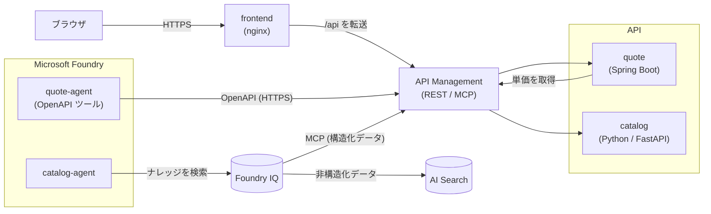

- Microsoft Foundry
  - Foundry Project
- AI Search
  - Knowledge Base : 以下ふたつの Knowledge Source を一つにしたもの
  - Knowledge Source
    1. MCP で catalog API に接続
    2. AI Search にインサートした index
- Azure API Management
- ACA Environment
  - ACA : frontend 
  - ACA : quote
  - ACA : catalog

# Catalog Agent

Catalog Agent は Foundry IQ を利用します。

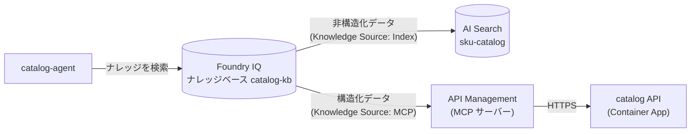

## 手順1. Foundry で Catalog Agent 作成

1. [Microsoft Foundry](https://ai.azure.com) にアクセスします。
2. `Project` が `iandm-project` になっていることを確認します。
   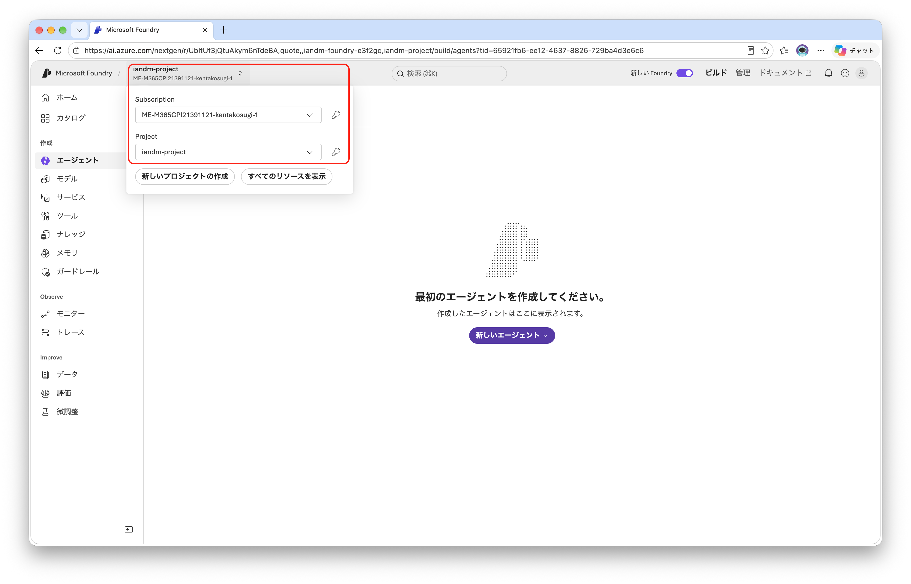
3. 左メニューから`エージェント`を選択します。
   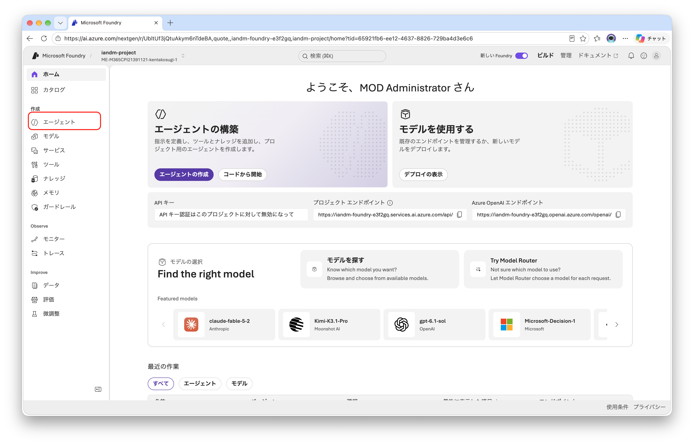
4. `新しいエージェント`→`エージェントの構築`の順に選択します。
   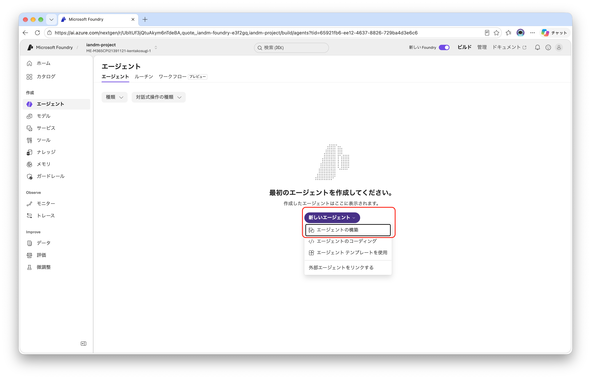
5. 以下を確認し、`エージェントを作成してプレイグラウンドを開く`を選択します。
   * `エージェント名`: `catalog-agent`
   * `対話モデル`: `テキスト`
   * `Use the Microsoft Copilot harnesses` : オフ

   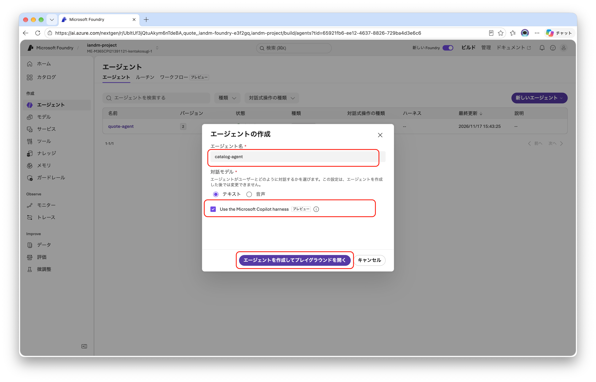

> [!NOTE]
> [Microsoft Copilot Harness](https://learn.microsoft.com/ja-jp/azure/foundry/agents/how-to/use-tools-skills-copilot-harness?tabs=python&pivots=portal) を説明しましょう。
> Copilot Harness をオンにして Agent をデプロイすると 2026/11/17 時点で `model-router` が見つからない旨のエラーが発生しました。

6. しばらく経つとエージェントの画面に遷移します。
   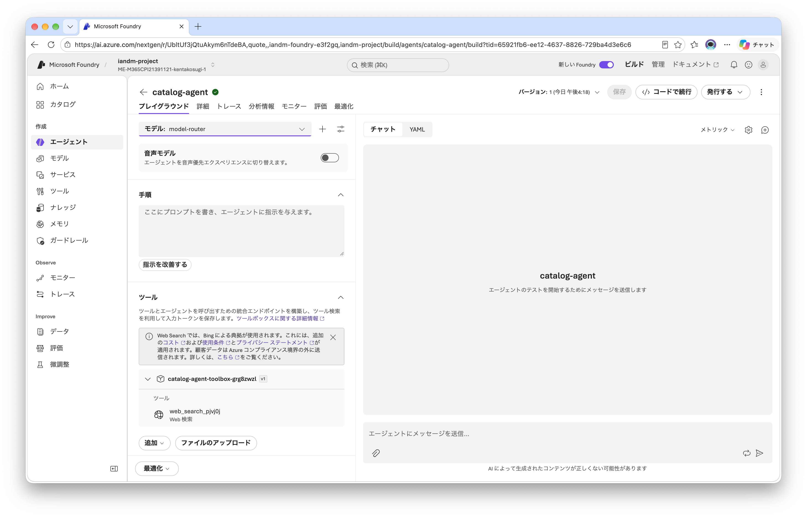
7. 規定では`モデル`が `model-router` になっているため、デプロイ済みの `gpt-5.4-mini` に変更します。
   
8. `手順` に以下を設定します。
   ```
   あなたは SKU カタログの担当エージェントです。SKU の機能、向いている場面、他の SKU との違い、ID、月額単価についての質問に答えます。
   
   ## 守ること
   - すべての質問に、ナレッジベースのツール (knowledge_base_retrieve) を使って答える。自分の知識では、絶対に答えない。
   - ナレッジベースに答えがない場合は、わかりませんと答える。推測しない。
   - 単価 (月額、円) は、ナレッジベースの構造化データ (カタログ) の値だけを使う。概要の文書に書かれた金額は、サンプルであり、根拠にしない。
   - 回答には、根拠にした情報の出典を付ける。
   - 回答は日本語で、簡潔にまとめる。
   
   ## 範囲外の依頼
   見積の作成、修正、保存、削除の依頼には、対応しない。見積は quote-agent の担当であることを伝える。
   ```
9. `ナレッジ`→`追加`→`Foundry IQ に接続する`を選択します。
   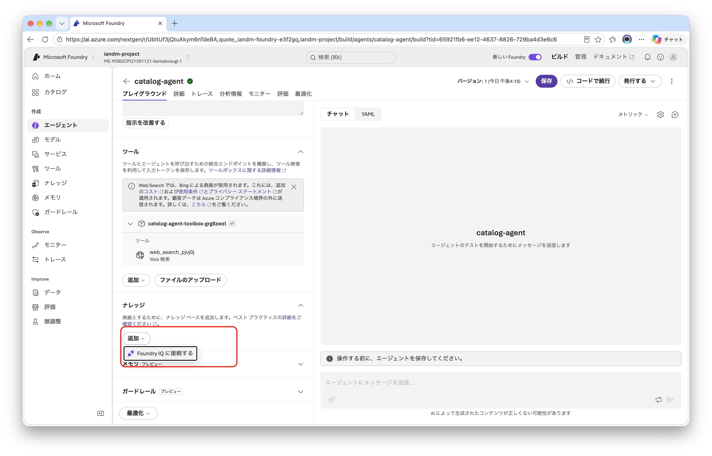　
10. `AI Search リソースに接続する` を選択します。
   
   * `エージェントを保存しますか？` のメッセージが出たら`保存`してください
11. 以下の値を設定して、`接続する`を選択します。
   * `Foundry IQ リソース` : `iandm-search-XXXXX`
   * `認証の種類` : `プロジェクトマネージド ID`
   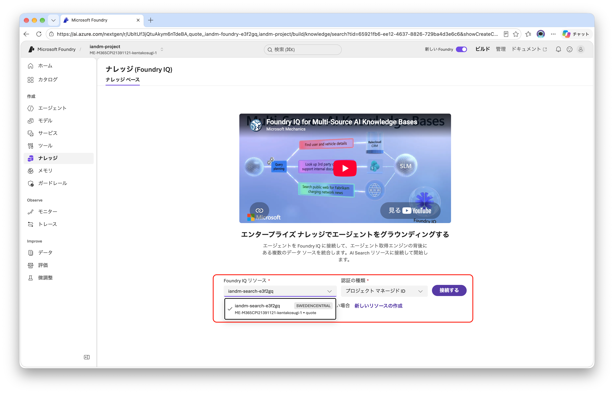
12. 左メニューから`エージェント`を選択し、エージェント一覧から`catalog-agent`を選択し直します。
13. `ナレッジ`→`追加`→`Foundry IQ に接続する`を選択します。
   
14. 以下の設定を実施して`接続`を選択します。
   * `接続`: `iandm-search-XXXXX`
   * `ナレッジベース`: `catalog-kb`
   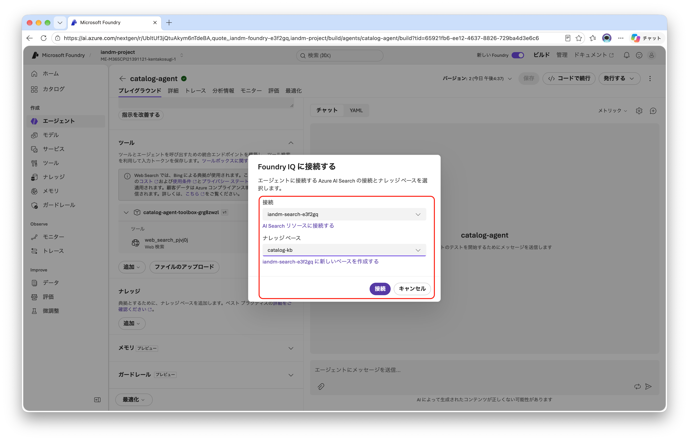
15. `保存`でエージェントを保存します。

## 手順2. Catalog Agent の実行

1. `Agent Playground` に以下の指示を実施します。
   ```
   どんな製品を扱っているか教えて
   ```

> [!NOTE]
> この質問では catalog API の結果のみ返しています。

2. 画像のような回答が返ってくるか確認します。
   
3. `Agent Playground` に以下の指示を実施します。
   ```
   金融に特化した製品を探しているんだけど
   ```

> [!NOTE]
> この質問では AI Search の INDEX を検索した結果のみ返しています。

4. 画像のような回答が返ってくるか確認します。
   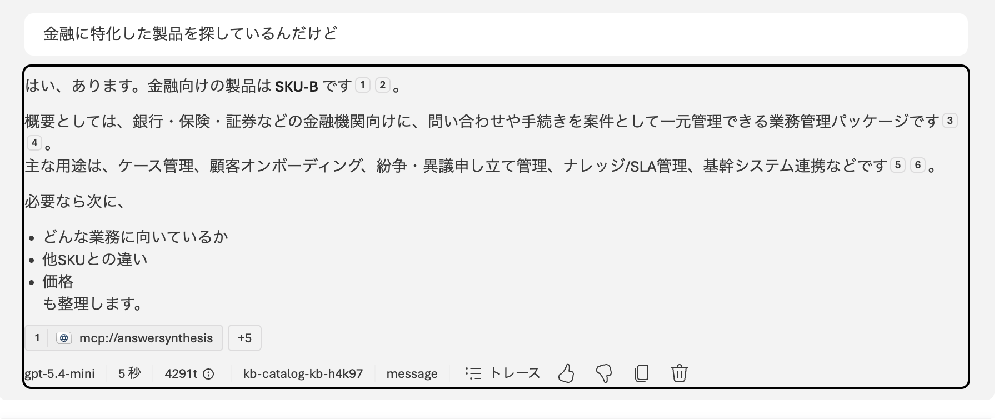
5. `Agent Playground` に以下の指示を実施します。
   ```
   顧客管理管理の製品を探していて、価格も知りたい。
   ```
   

> [!NOTE]
> **この質問は catalog API が所持する単価に加え AI Search の持つ製品の特徴ふたつのデータをマッシュアップしないと返却できません。** この質問が最も Foundry IQ を使っている質問になります。

# Quote Agent

Quote Agent は OpenAPI ツールで quote API を呼び出します。

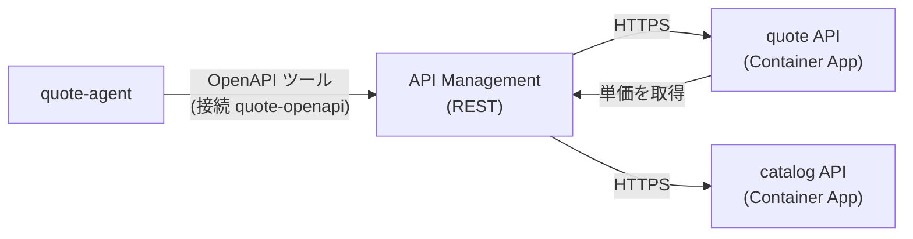

## 手順1. : Foundry で Quote Agent 作成

1. [Microsoft Foundry](https://ai.azure.com) にアクセスします。
2. `Project` が `iandm-project` になっていることを確認します。
   
3. 左メニューから`エージェント`を選択します。
   
4. `新しいエージェント`→`エージェントの構築`の順に選択します。
   
5. 以下を確認し、`エージェントを作成してプレイグラウンドを開く`を選択します。
   * `エージェント名`: `quote-agent`
   * `対話モデル`: `テキスト`
   * `Use the Microsoft Copilot harnesses` : 自由

   
   
6. しばらく経つとエージェントの画面に遷移します。
   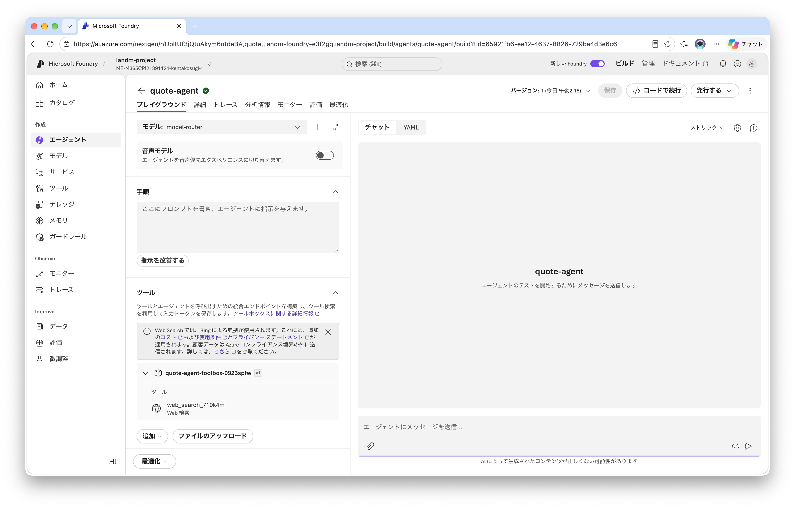
7. 規定ではモデルが`model-router`になっているため、デプロイ済みの`gpt-5.4-mini`に変更します。
   

> [!NOTE]
> model-router の説明を実施する

8. `<frontend の URL>`を実際の値に変えて`手順`に以下を設定します。
   ```
   あなたは見積の担当エージェントです。見積の作成、取得、修正、保存、削除の依頼を、OpenAPI ツールで実行します。
   
   ## 役割
   - 利用者の依頼を解釈し、ツールに渡す値 (契約開始日、契約終了日、SKU の ID、数量、割引率) を整える。
   - 実行した結果を、日本語で簡潔に伝える。
   
   ## 守ること
   - 金額の計算や、SKU の組み合わせの制約の検査は、自分で行わない。API が行う。回答の金額は、API が返した値だけを使う。
   - 単価は指定できない。SKU の ID と数量だけを渡す。単価は API がカタログから決める。
   - 不足している値は、推測せず、利用者に確認する。
   - API がエラーを返したら、その理由を、そのまま分かりやすく伝える。値を変えて、黙って再試行しない。
   - 見積は、まずドラフトとして作成する。保存 (確定) と削除は、利用者が明確に依頼したときだけ行う。
   - SKU の機能や違いなど、見積の操作以外の質問には、答えない。catalog-agent へ案内する。
   
   ## 見積システム
   利用者が画面での操作を希望したら、次の URL を案内する。
   <frontend の URL>
   ```
   * frontend の URL を確認する方法
   ```bash
   $ azd env get-values | grep frontendUrl
   ```
9. `ツール`→`追加`→`ツールの追加`の順に選択します。
   
10. `カスタム`を選択します。
   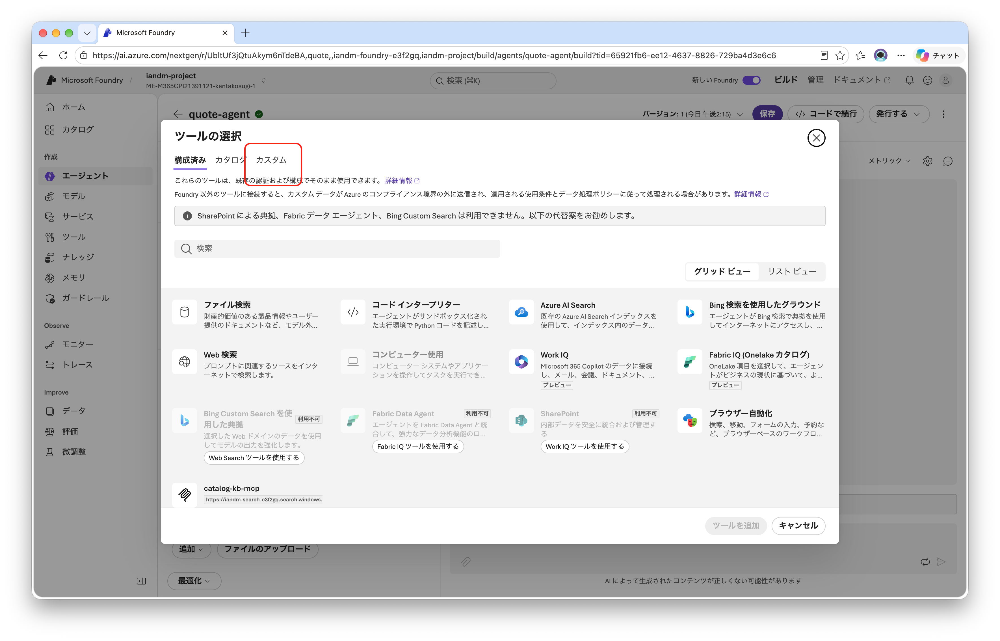
11. `OpenAPI ツール` を選択します。
   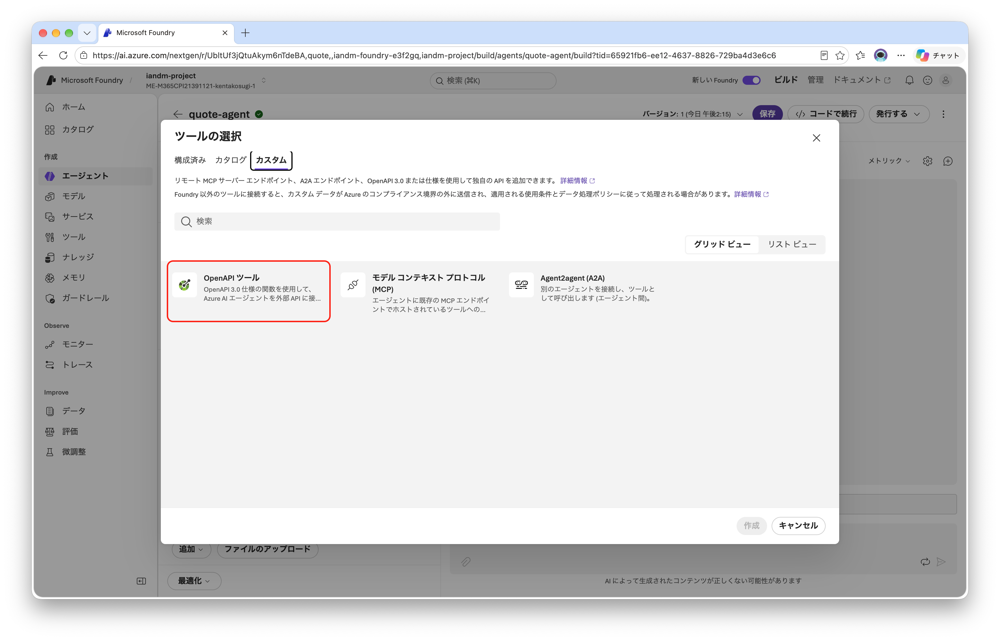
12. 以下を設定して、`ツールの作成`を選択
   * `名前` : `quoteapi`
   * `説明` : `見積 API。見積の一覧取得、1 件の取得、作成、修正、保存 (確定)、削除を行う。見積に関する依頼のときに使う。金額の計算と、SKU の組み合わせの検査は、この API が行う。SKU の機能や単価の質問には使わない。`
   * `認証方法`: `匿名`
   * `接続`: `quote-openapi`
      * 作成済みのものを選択すること
   * `OpenAPI 3.0+ スキーマ`: 
      * 以下を実行してダウンロードされた `quote_openapi+json.json` の内容を貼り付ける
      ```bash
      $ eval "$(azd env get-values | sed 's/^/export /')"
      $ az apim api export --subscription "$AZURE_SUBSCRIPTION_ID" -g "$AZURE_RESOURCE_GROUP" --service-name "$apimName" --api-id quote --export-format OpenApiJsonFile --file-path ./
      ```
13. `保存`を押してエージェントの完成です。

## 手順2. Quote Agent の実行

1. `Agent Playground`のチャット欄に以下を入力します。
   ```
   見積もりをお願いしたいんだけど
   ```
2. 画像のような回答が返ってきます。
   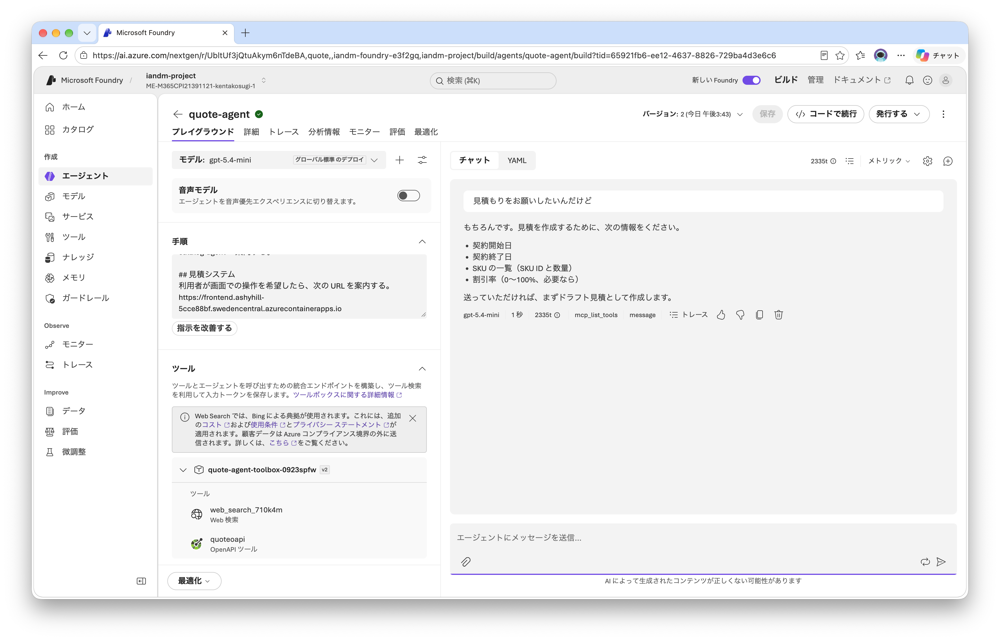
3. `Agent Playground` のチャット欄に以下を入力します。
   ```
   見積もり期間は 2027/01/01 - 2029/12/31 の 3 年間、SKU は SKU-STANDARD1本 と SKU-PROFESSIONAL3本、割引率は5%で
   ```
4. `SKU-STANDARD` と `SKU-PROFESSIONAL` は組み合わせることが不可能な SKU であり、その旨が返ってきたら成功です。
   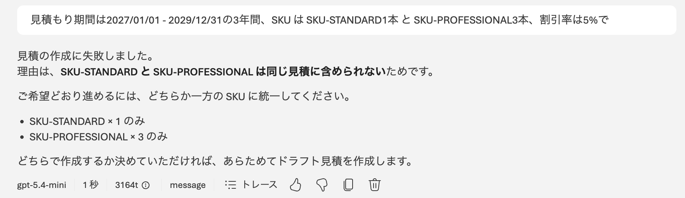
5. `Agent Playground` に以下を入力します。
   ```
   SKU-STANDARD 1 本を SKU-C 3 本に変えて再見積もりして
   ```
6. 画像のような回答が返ってきます。
   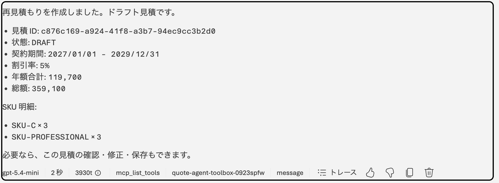
7. 見積もりシステムにアクセスして、Agent が作成した見積もりを確認します。
   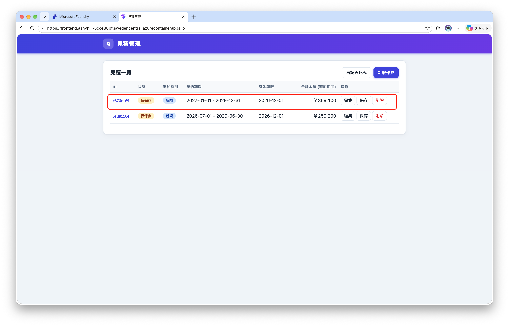
8. `qutoe-id` が一致する見積もりをドリルダウンします。
   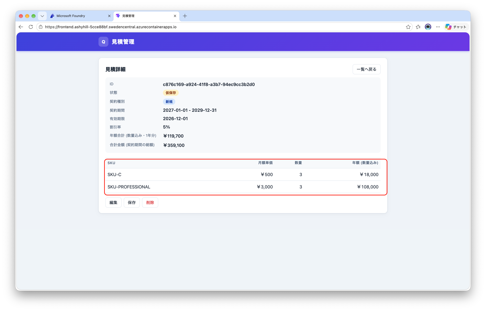

> [!NOTE]
> Agent に依頼した内容と合致しているか確認します。

9. `Agent Playground`に戻り、`仮保存`から`保存`するよう依頼します。
   ```
   仮保存から保存に変更して
   ```
10. 画像のような回答が返ってきます。
   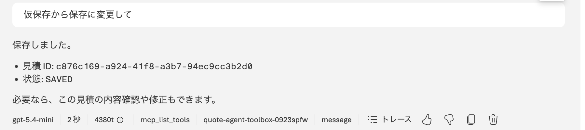
11. 見積もりシステムに移動し、ブラウザを更新して`保存`に変更されているかを確認します。
   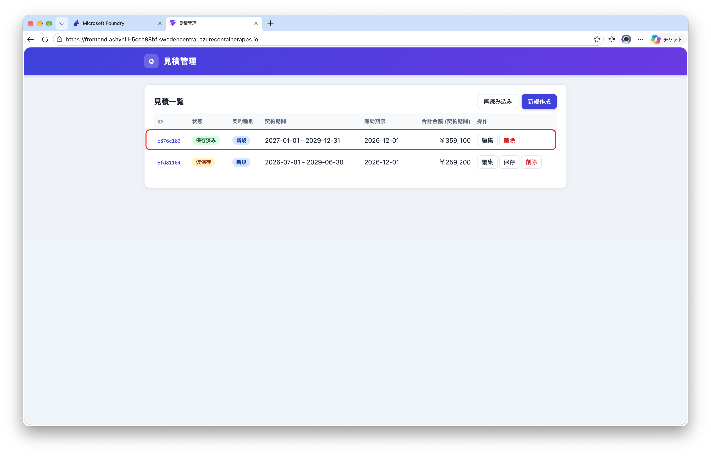

> [!TIP]
> 変更や削除等も依頼してみましょう。
> OpenAPI を通じて LLM が間違った操作をしないことを確認します。
> 
> -と + の SKU が組み合わさると契約タイプが `Early Renewal` に変化することも確認できます。
> アプリケーションが持つ`知識`: ビジネスロジックをそのまま適用することが可能です。

# オーケストレーター層を導入し、A2A を使う
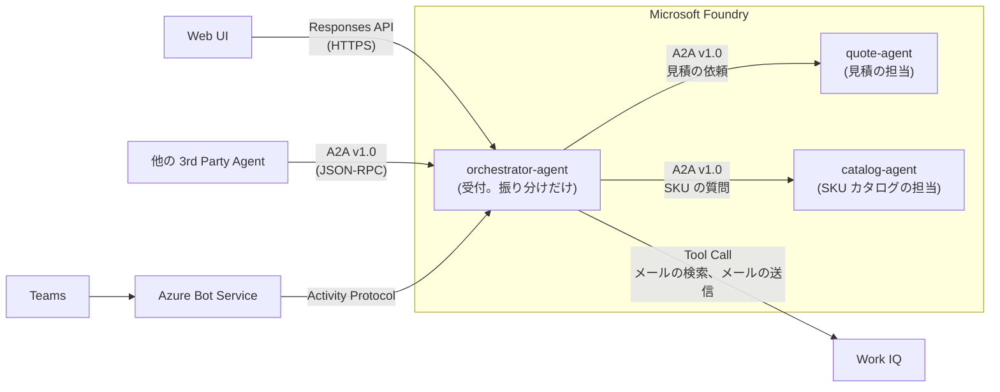

オーケストレーターは、catalog-agent と quote-agent を A2A (Agent2Agent) で呼び出します。呼び出される側の 2 つのエージェントでは、受信側の A2A を有効にして、エージェントカードを設定します。設定は、Foundry のポータルのエージェントの`詳細`タブにある `エンドポイント` の `A2A プロトコル` で行います。

## 手順1. catalog-agent の A2A を設定する

1. Foundry の左メニューから`エージェント`を選択し、`catalog-agent` を選択して、`詳細`タブを開きます。
2. `A2A プロトコル` の `セットアップ` を選択します。`エージェント カードの編集`画面が開くので、以下を設定して`保存`を選択します。保存すると、A2A が有効になります。

   | 項目 | 値 |
   |---|---|
   | `名前` | `catalog-agent` |
   | `説明` | `SKU カタログの担当エージェント。SKU の機能、向いている場面、他の SKU との違い、ID、月額単価についての質問に答える。回答は、ナレッジベース (SKU の概要の文書と、カタログの構造化データ) の内容だけを根拠にし、出典を付ける。単価は、カタログの値だけを使う。見積の作成、修正、保存、削除は担当外で、quote-agent が担当する。` |

   `エージェントのスキル` の `追加`を選択して、次の 4 つのスキルを登録します。

   | スキル名 | タグ | スキルの説明 | サンプル プロンプト |
   |---|---|---|---|
   | `Describe_SKU_Features` | `catalog, sku, read` | `SKU の機能、特徴、向いている場面を、ナレッジベースの文書から調べて説明する。ナレッジベースに答えがない場合は、わかりませんと答える。` | `SKU-D の概要を教えて` |
   | `Compare_SKUs` | `catalog, sku, read` | `複数の SKU の違いと使い分けを、ナレッジベースの内容にもとづいて説明する。` | `SKU-A と SKU-B の違いを教えて` |
   | `Check_SKU_Price` | `catalog, price, read` | `SKU の ID と月額単価 (円) を返す。単価は、カタログの構造化データの値だけを使い、概要の文書に書かれた金額は根拠にしない。` | `SKU-D の月額単価を教えて` |
   | `List_SKUs` | `catalog, sku, read` | `カタログにある製品 (SKU) の一覧を、ID と月額単価つきで返す。` | `製品 (SKU) の一覧を教えて` |
3. 保存後、`A2A プロトコル` が `アクティブ` になります。`エンドポイント` のコピーボタンで、エンドポイントの URL をコピーします。次の値を、手順4 で使うためにメモします。

   | 項目 | 値 |
   |---|---|
   | A2A のエンドポイント (A2A base path) | `https://iandm-foundry-e3f2gq.services.ai.azure.com/api/projects/iandm-project/agents/catalog-agent/endpoint/protocols/a2a` |
   | エージェントカードの URL (v1.0) | `<A2A のエンドポイント>/agentCard/v1.0` |
   | プロトコル | A2A v1.0 (JSON-RPC)。ストリーミングは非対応 |
   | 認証 | Microsoft Entra ID。トークンの対象 (audience) は `https://ai.azure.com` |

## 手順2. quote-agent の A2A を設定する

1. Foundry の左メニューから`エージェント`を選択し、`quote-agent` を選択して、`詳細`タブを開きます。
2. `A2A プロトコル` の `セットアップ` を選択します。`エージェント カードの編集`画面が開くので、以下を設定して`保存`を選択します。保存すると、A2A が有効になります。

   | 項目 | 値 |
   |---|---|
   | `名前` | `quote-agent` |
   | `説明` | `見積の担当エージェント。見積の一覧と取得、作成、修正、保存、削除の依頼を受け付ける。金額の計算と SKU の組み合わせの検査は見積 API が行い、このエージェントは依頼の解釈と結果の説明だけを担当する。SKU の機能や違い、月額単価の質問は担当外で、catalog-agent が担当する。` |

   `エージェントのスキル` の `追加`を選択して、次の 5 つのスキルを登録します。

   | スキル名 | タグ | スキルの説明 | サンプル プロンプト |
   |---|---|---|---|
   | `Get_Quotes` | `quote, read` | `見積の一覧を返す。見積 ID を指定された場合は、その見積の明細、合計金額、状態 (DRAFT または SAVED) を返す。` | `見積の一覧を教えて` |
   | `Create_Draft_Quote` | `quote, write` | `契約開始日、契約終了日、製品 (SKU) の ID と数量、割引率から、見積をドラフトとして作成する。単価は指定できず、API がカタログから決める。不足している値は、利用者に確認する。` | `SKU-D を 10 個、2026-07-01 から 2029-06-30 で見積を作って` |
   | `Revise_Quote` | `quote, write` | `既存の見積の明細、数量、契約期間、割引率を修正する。修正した見積はドラフトに戻る。` | `見積 (ID) の数量を 20 個に変えて` |
   | `Save_Quote` | `quote, write, confirm` | `ドラフトの見積を保存 (SAVED) する。利用者が保存を明確に依頼したときだけ実行する。` | `見積 (ID) をこれで確定して` |
   | `Delete_Quote` | `quote, write, confirm` | `見積を削除する。利用者が削除を明確に依頼したときだけ実行する。` | `見積 (ID) を削除して` |
3. 保存後、`A2A プロトコル` が `アクティブ` になります。`エンドポイント` のコピーボタンで、エンドポイントの URL をコピーします。次の値を、手順4 で使うためにメモします。

   | 項目 | 値 |
   |---|---|
   | A2A のエンドポイント (A2A base path) | `https://iandm-foundry-e3f2gq.services.ai.azure.com/api/projects/iandm-project/agents/quote-agent/endpoint/protocols/a2a` |
   | エージェントカードの URL (v1.0) | `<A2A のエンドポイント>/agentCard/v1.0` |
   | プロトコル | A2A v1.0 (JSON-RPC)。ストリーミングは非対応 |
   | 認証 | Microsoft Entra ID。トークンの対象 (audience) は `https://ai.azure.com` |

> [!NOTE]
> エージェントカードの `description` と `skills` は、オーケストレーターのモデルが、どの担当に依頼するかを判断する材料になります。担当外の範囲 (見積と SKU の分担) も、description に書いておきます。

## 手順3. orchestrator-agent を作成する

Quote Agent の手順1 と同じ手順で、`orchestrator-agent` を作成します。モデルは `gpt-5.4-mini` にして、`手順` に以下を設定します。

```markdown
あなたは受付のエージェントです。利用者の依頼を、適切な担当エージェントに振り分けます。自分では業務を行いません。

## 担当
- 見積の作成、取得、一覧、修正、保存、削除: quote-agent
- SKU (製品) の機能、向いている場面、他の SKU との違い、ID、月額単価、一覧の質問: catalog-agent
- 「製品」は SKU のことです。「製品一覧」は SKU の一覧として扱う。

## 守ること
- 金額の計算、SKU の説明、見積の操作は、自分で行わない。必ず担当エージェントに任せる。自分の知識では、絶対に答えない。
- 回答は、担当エージェントが返した内容だけを使う。値を変えたり、補ったり、再計算したりしない。
- 担当エージェントに依頼するときは、利用者が言った内容 (SKU の ID、数量、日付、割引率、見積の ID) を、省略せず、そのまま渡す。会話の前の内容が必要な場合は、必要な値を補って渡す。
- 保存と削除は、利用者が明確に依頼したときだけ、担当に依頼する。依頼が曖昧なときは、利用者に確認する。
- どの担当か判断できない場合は、推測で振り分けず、利用者に確認する。
- 依頼が、見積と SKU の両方にまたがる場合は、それぞれの担当に依頼して、結果を並べて伝える。たとえば、SKU の単価を聞いてから見積を作る場合でも、単価は、見積を担当する側が API から決める。
- 担当エージェントが、確認や不足している値を求めた場合は、そのまま利用者に伝える。利用者の返事を、担当に渡す。
- 担当エージェントが、エラーを返した場合は、その理由を、そのまま分かりやすく伝える。値を変えて、黙って再試行しない。

## 範囲外の依頼
見積と SKU のどちらでもない依頼 (天気、一般的な質問など) には、対応できないと伝える。

## 回答
日本語で、簡潔にまとめる。どの担当に任せたかを、一言で添える (例: 見積の担当に確認しました)。
```

## 手順4. orchestrator-agent のツールに A2A を追加する

呼び出し先ごとに A2A の接続を作成し、`orchestrator-agent` のツールとして追加します。接続の作成には `Foundry Project Manager` ロールが必要です。

> [!CAUTION]
> **Toolbox に A2A を追加しないでください。** Toolbox 経由で追加した A2A は、認証の関係上、機能しません。A2A は、必ず、エージェントのツールとして直接追加します。
> ツールの追加画面で Toolbox に追加する選択肢が出た場合も、選ばないでください。

1. 左メニューから`ツール`→`ツールを接続する`の順に選択します。
2. `カスタム`→`Agent2Agent (A2A)`の順に選択して、`作成`を選択します。
3. catalog-agent の接続として、以下を設定して作成します。
   * `名前` : `catalog`
   * `A2A Agent Endpoint` : 手順1 でメモした catalog-agent の A2A のエンドポイント
   * `認証` : `プロジェクトのマネージド ID`
   * `Audience` : `https://ai.azure.com`

> [!NOTE]
> エージェントカードのパス (`/agentCard/v1.0`) は、接続に設定しません。Foundry が既定のパスを解決して、プロトコルのバージョンも自動で選びます。

4. quote-agent の接続として、以下を設定して作成します。
   * `名前` : `quote`
   * `A2A Agent Endpoint` : 手順2 でメモした quote-agent の A2A のエンドポイント
   * `認証` : `プロジェクトのマネージド ID`
   * `Audience` : `https://ai.azure.com`
5. 左メニューから`エージェント`を選択し、`orchestrator-agent` を選択します。
6. `ツール`→`追加`→`ツールの追加`の順に選択し、`カスタム`の `Agent2Agent (A2A)` から接続 `catalog` を選択して追加します。
7. 同様に、接続 `quote` も追加します。
8. `保存`でエージェントを保存します。

> [!NOTE]
> プロジェクトのマネージド ID には、`Foundry Agent Consumer` ロールが必要です。デプロイ (Bicep) でプロジェクト スコープに付与済みです。
> 呼ばれる側 (catalog-agent と quote-agent) の受信側の A2A は、手順1 と手順2 で有効にしています。有効にしていないと、呼び出しは失敗します。

## 手順5. orchestrator-agent の実行

1. `orchestrator-agent` の `Agent Playground` のチャット欄に、以下を入力します。
   ```
   2027-01-01 - 2029-12-31 金融特化の SKU 5本と ITSM 特化の PRO の SKU 3本、割引率5%で見積もりを作成して
   ```
2. 次の流れで処理されることを確認します。
   * orchestrator-agent が、`金融特化` と `ITSM 特化の PRO` の SKU の ID を、catalog-agent に A2A で問い合わせる (`SKU-B` と `SKU-PROFESSIONAL`)。
   * orchestrator-agent が、SKU の ID、数量、契約期間、割引率を、quote-agent に A2A で渡して、見積の作成を依頼する。
   * 回答に、どの担当に任せたかが添えられ、quote-agent が返した見積の内容 (見積の ID、明細、合計金額、状態 DRAFT) が、そのまま伝えられる。

> [!NOTE]
> orchestrator-agent は、SKU の ID を自分では決めず、金額も計算しません。SKU の特定は catalog-agent、見積の作成と金額の計算は quote-agent (と quote API) が行います。
> `トレース`タブで、orchestrator-agent から 2 つのエージェントへの A2A の呼び出しを確認できます。
