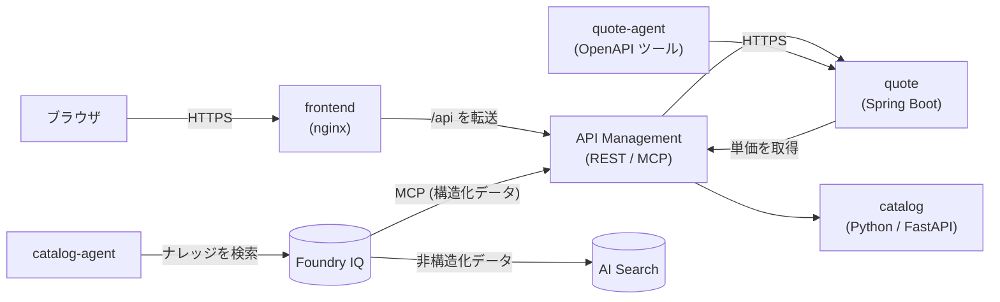
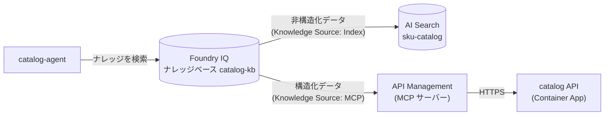
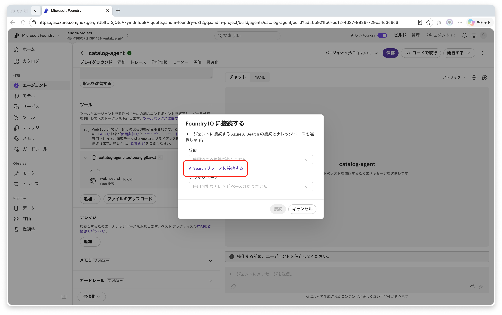
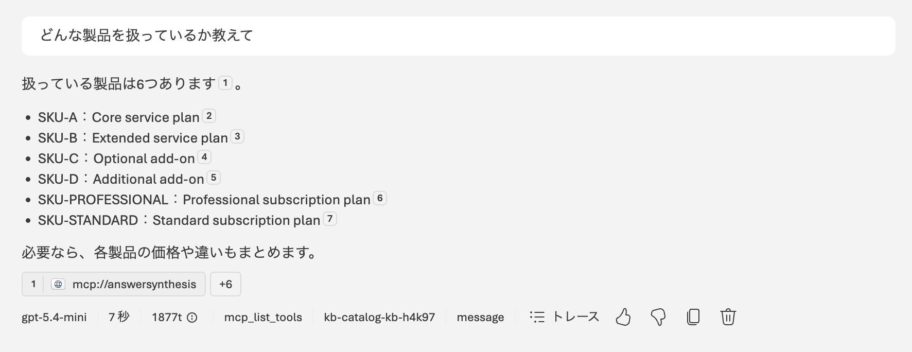
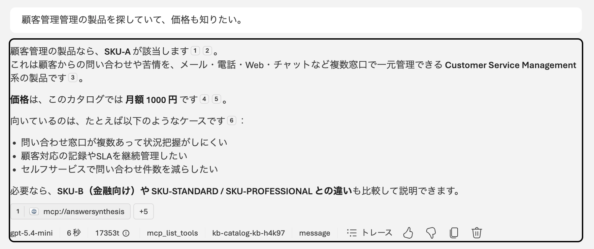
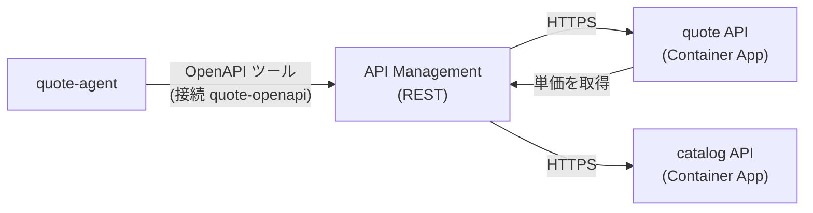
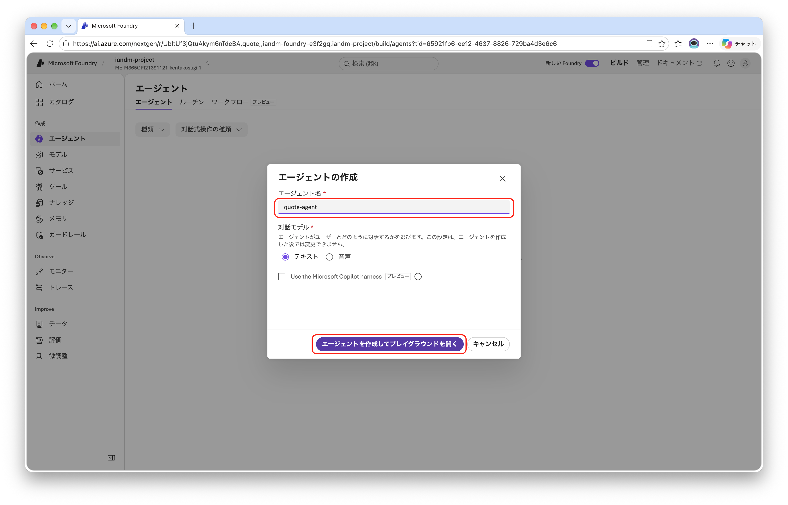
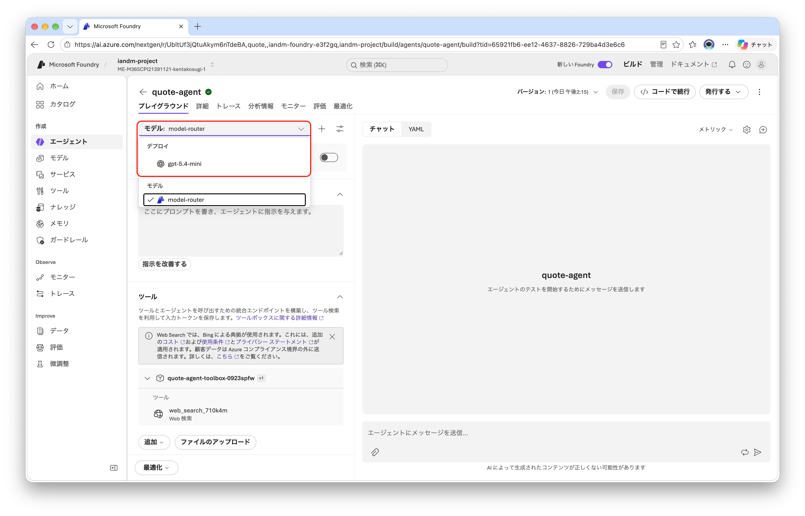
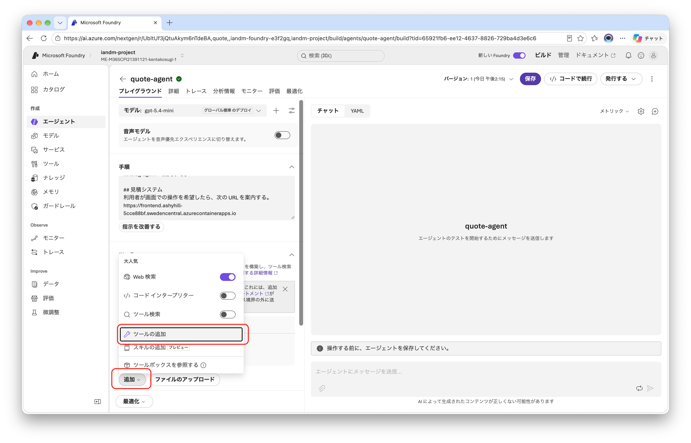

# 事前準備
[README](./README.md) を読み、Azure のリソースを作成します。作成されるリソースは以下の通りです。



- Microsoft Foundry
  - Foundry Project
- AI Search
  - Knowledge Base : 以下ふたつの Knowledge Source を一つにしたもの
  - Knowledge Source
    1. MCP で catalog API に接続
    2. AI Search にインサートした index
- Azure API Management
- ACA Environment
  - ACA : frontend 
  - ACA : quote
  - ACA : catalog

# Catalog Agent

Catalog Agent は Foundry IQ を利用します。



## 手順1. Foundry で Catalog Agent 作成

1. [Microsoft Foundry](https://ai.azure.com) にアクセスします。
2. `Project` が `iandm-project` になっていることを確認します。
   
3. 左メニューから`エージェント`を選択します。
   
4. `新しいエージェント`→`エージェントの構築`の順に選択します。
   
5. 以下を確認し、`エージェントを作成してプレイグラウンドを開く`を選択します。
   * `エージェント名`: `catalog-agent`
   * `対話モデル`: `テキスト`
   * `Use the Microsoft Copilot harnesses` : オフ

   

> [!NOTE]
> [Microsoft Copilot Harness](https://learn.microsoft.com/ja-jp/azure/foundry/agents/how-to/use-tools-skills-copilot-harness?tabs=python&pivots=portal) を説明しましょう。
> Copilot Harness をオンにして Agent をデプロイすると 2026/11/17 時点で `model-router` が見つからない旨のエラーが発生しました。

6. しばらく経つとエージェントの画面に遷移します。
   
7. 規定では`モデル`が `model-router` になっているため、デプロイ済みの `gpt-5.4-mini` に変更します。
   
8. `手順` に以下を設定します。
   ```
   あなたは SKU カタログの担当エージェントです。SKU の機能、向いている場面、他の SKU との違い、ID、月額単価についての質問に答えます。
   
   ## 守ること
   - すべての質問に、ナレッジベースのツール (knowledge_base_retrieve) を使って答える。自分の知識では、絶対に答えない。
   - ナレッジベースに答えがない場合は、わかりませんと答える。推測しない。
   - 単価 (月額、円) は、ナレッジベースの構造化データ (カタログ) の値だけを使う。概要の文書に書かれた金額は、サンプルであり、根拠にしない。
   - 回答には、根拠にした情報の出典を付ける。
   - 回答は日本語で、簡潔にまとめる。
   
   ## 範囲外の依頼
   見積の作成、修正、保存、削除の依頼には、対応しない。見積は quote-agent の担当であることを伝える。
   ```
9. `ナレッジ`→`追加`→`Foundry IQ に接続する`を選択します。
   　
10. `AI Search リソースに接続する` を選択します。
   
   * `エージェントを保存しますか？` のメッセージが出たら`保存`してください
11. 以下の値を設定して、`接続する`を選択します。
   * `Foundry IQ リソース` : `iandm-search-XXXXX`
   * `認証の種類` : `プロジェクトマネージド ID`
   
12. 左メニューから`エージェント`を選択し、エージェント一覧から`catalog-agent`を選択し直します。
13. `ナレッジ`→`追加`→`Foundry IQ に接続する`を選択します。
   
14. 以下の設定を実施して`接続`を選択します。
   * `接続`: `iandm-search-XXXXX`
   * `ナレッジベース`: `catalog-kb`
   
15. `保存`でエージェントを保存します。

## 手順2. Catalog Agent の実行

1. `Agent Playground` に以下の指示を実施します。
   ```
   どんな製品を扱っているか教えて
   ```

> [!NOTE]
> この質問では catalog API の結果のみ返しています。

2. 画像のような回答が返ってくるか確認します。
   
3. `Agent Playground` に以下の指示を実施します。
   ```
   金融に特化した製品を探しているんだけど
   ```

> [!NOTE]
> この質問では AI Search の INDEX を検索した結果のみ返しています。

4. 画像のような回答が返ってくるか確認します。
   
5. `Agent Playground` に以下の指示を実施します。
   ```
   顧客管理管理の製品を探していて、価格も知りたい。
   ```
   

> [!NOTE]
> **この質問は catalog API が所持する単価に加え AI Search の持つ製品の特徴ふたつのデータをマッシュアップしないと返却できません。** この質問が最も Foundry IQ を使っている質問になります。

# Quote Agent

Quote Agent は OpenAPI ツールで quote API を呼び出します。



## 手順1. : Foundry で Quote Agent 作成

1. [Microsoft Foundry](https://ai.azure.com) にアクセスします。
2. `Project` が `iandm-project` になっていることを確認します。
   
3. 左メニューから`エージェント`を選択します。
   
4. `新しいエージェント`→`エージェントの構築`の順に選択します。
   
5. 以下を確認し、`エージェントを作成してプレイグラウンドを開く`を選択します。
   * `エージェント名`: `quote-agent`
   * `対話モデル`: `テキスト`
   * `Use the Microsoft Copilot harnesses` : 自由

   
   
6. しばらく経つとエージェントの画面に遷移します。
   
7. 規定ではモデルが`model-router`になっているため、デプロイ済みの`gpt-5.4-mini`に変更します。
   

> [!NOTE]
> model-router の説明を実施する

8. `<frontend の URL>`を実際の値に変えて`手順`に以下を設定します。
   ```
   あなたは見積の担当エージェントです。見積の作成、取得、修正、保存、削除の依頼を、OpenAPI ツールで実行します。
   
   ## 役割
   - 利用者の依頼を解釈し、ツールに渡す値 (契約開始日、契約終了日、SKU の ID、数量、割引率) を整える。
   - 実行した結果を、日本語で簡潔に伝える。
   
   ## 守ること
   - 金額の計算や、SKU の組み合わせの制約の検査は、自分で行わない。API が行う。回答の金額は、API が返した値だけを使う。
   - 単価は指定できない。SKU の ID と数量だけを渡す。単価は API がカタログから決める。
   - 不足している値は、推測せず、利用者に確認する。
   - API がエラーを返したら、その理由を、そのまま分かりやすく伝える。値を変えて、黙って再試行しない。
   - 見積は、まずドラフトとして作成する。保存 (確定) と削除は、利用者が明確に依頼したときだけ行う。
   - SKU の機能や違いなど、見積の操作以外の質問には、答えない。catalog-agent へ案内する。
   
   ## 見積システム
   利用者が画面での操作を希望したら、次の URL を案内する。
   <frontend の URL>
   ```
   * frontend の URL を確認する方法
   ```bash
   $ azd env get-values | grep frontendUrl
   ```
9. `ツール`→`追加`→`ツールの追加`の順に選択します。
   
10. `カスタム`を選択します。
   
11. `OpenAPI ツール` を選択します。
   
12. 以下を設定して、`ツールの作成`を選択
   * `名前` : `quoteapi`
   * `説明` : `見積 API。見積の一覧取得、1 件の取得、作成、修正、保存 (確定)、削除を行う。見積に関する依頼のときに使う。金額の計算と、SKU の組み合わせの検査は、この API が行う。SKU の機能や単価の質問には使わない。`
   * `認証方法`: `匿名`
   * `接続`: `quote-openapi`
      * 作成済みのものを選択すること
   * `OpenAPI 3.0+ スキーマ`: 
      * 以下を実行してダウンロードされた `quote_openapi+json.json` の内容を貼り付ける
      ```bash
      $ eval "$(azd env get-values | sed 's/^/export /')"
      $ az apim api export --subscription "$AZURE_SUBSCRIPTION_ID" -g "$AZURE_RESOURCE_GROUP" --service-name "$apimName" --api-id quote --export-format OpenApiJsonFile --file-path ./
      ```
13. `保存`を押してエージェントの完成です。

## 手順2. Quote Agent の実行

1. `Agent Playground`のチャット欄に以下を入力します。
   ```
   見積もりをお願いしたいんだけど
   ```
2. 画像のような回答が返ってきます。
   
3. `Agent Playground` のチャット欄に以下を入力します。
   ```
   見積もり期間は 2027/01/01 - 2029/12/31 の 3 年間、SKU は SKU-STANDARD1本 と SKU-PROFESSIONAL3本、割引率は5%で
   ```
4. `SKU-STANDARD` と `SKU-PROFESSIONAL` は組み合わせることが不可能な SKU であり、その旨が返ってきたら成功です。
   
5. `Agent Playground` に以下を入力します。
   ```
   SKU-STANDARD 1 本を SKU-C 3 本に変えて再見積もりして
   ```
6. 画像のような回答が返ってきます。
   
7. 見積もりシステムにアクセスして、Agent が作成した見積もりを確認します。
   
8. `qutoe-id` が一致する見積もりをドリルダウンします。
   

> [!NOTE]
> Agent に依頼した内容と合致しているか確認します。

9. `Agent Playground`に戻り、`仮保存`から`保存`するよう依頼します。
   ```
   仮保存から保存に変更して
   ```
10. 画像のような回答が返ってきます。
   
11. 見積もりシステムに移動し、ブラウザを更新して`保存`に変更されているかを確認します。
   

> [!TIP]
> 変更や削除等も依頼してみましょう。
> OpenAPI を通じて LLM が間違った操作をしないことを確認します。
> 
> -と + の SKU が組み合わさると契約タイプが `Early Renewal` に変化することも確認できます。
> アプリケーションが持つ`知識`: ビジネスロジックをそのまま適用することが可能です。